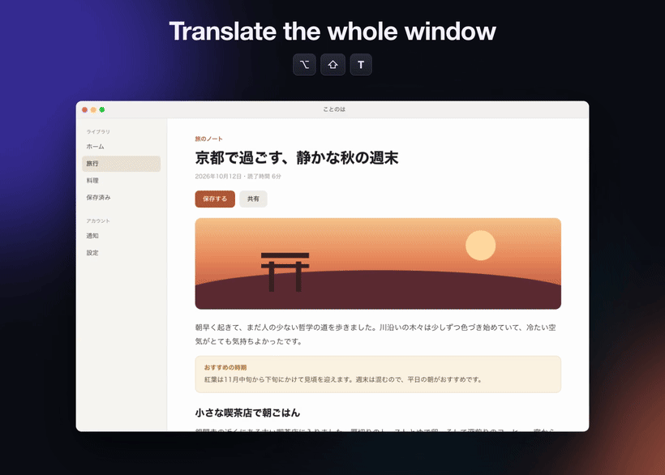
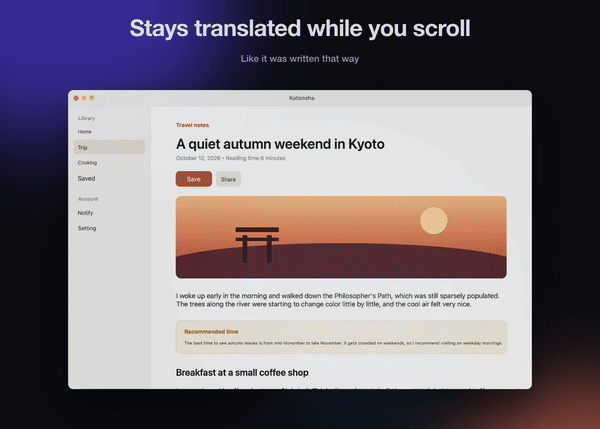
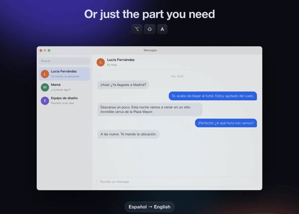
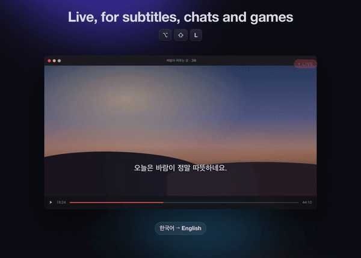
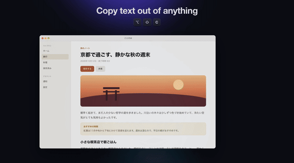

<div align="center">

# Lingveil

**Your screen, in your language.**

Press a shortcut and every label, message and paragraph on screen is repainted in your language, in the same spot, with the app's own colors and type.

[](https://github.com/aaditya-v-more/lingveil/releases/latest)


[](https://ko-fi.com/aadityavmore)



**[▶ Watch the 45-second demo](docs/media/lingveil-demo.mp4)** · **[Download](https://github.com/aaditya-v-more/lingveil/releases/latest)**

</div>

---

## Install

### Mac

1. Download **`Lingveil-<version>-mac.zip`** from the [latest release](https://github.com/aaditya-v-more/lingveil/releases/latest) and unzip it.
2. Drag **Lingveil.app** into **Applications**.
3. Open it. The app isn't notarized yet, so the first time macOS will refuse: right-click Lingveil.app → **Open** → **Open**, or run
   ```sh
   xattr -dr com.apple.quarantine /Applications/Lingveil.app
   ```
4. Grant **Screen Recording** when asked (required: it's how Lingveil sees the text). **Accessibility** is optional and gives exact app text and translation of selected text.

Lingveil lives in the menu bar. Needs macOS 15 or later; Intel and Apple silicon both work, and local models and open-source voices need Apple silicon.

### Windows

1. Download **`Lingveil-<version>-windows-x64.zip`** from the [latest release](https://github.com/aaditya-v-more/lingveil/releases/latest).
2. Unzip it anywhere, for example `C:\Users\<you>\Apps\Lingveil`, and run **Lingveil.exe**. Nothing else to install; .NET is bundled.
3. The exe isn't code-signed yet, so SmartScreen may warn on first run: **More info** → **Run anyway**.

Lingveil lives in the system tray. Windows 10 or 11, x64.

### Build from source

<details>
<summary>Mac</summary>

```sh
git clone https://github.com/aaditya-v-more/lingveil && cd lingveil
./build.sh            # universal build into build/Lingveil.app
ARCHS=arm64 ./build.sh
```

Needs the Xcode command-line tools and CMake. The first build also builds llama.cpp's server from `../llama.cpp` (or `LLAMA_CPP_DIR`).
</details>

<details>
<summary>Windows</summary>

```powershell
cd windows
./fetch-llama.ps1
dotnet publish Lingveil.App -c Release -r win-x64 --self-contained
```

Needs the .NET 8 SDK.
</details>

## What it does

<table>
<tr>
<td width="50%"><br><b>Stays translated while you scroll.</b> Translations follow the page as it moves, and text you scroll back to comes back instantly.</td>
<td width="50%"><br><b>Translate just an area.</b> Drag over a chat, a dialog or a menu and only that part changes.</td>
</tr>
<tr>
<td><br><b>Live mode.</b> An area keeps translating as it changes: subtitles, chats, games.</td>
<td><br><b>Copy text out of anything.</b> Drag over an image, a video or an app that won't let you select, and its text goes on the clipboard.</td>
</tr>
</table>

Also: translate the paragraph under the pointer or the selected text in a small card, read text aloud in its own language or translated, and translate web pages paragraph by paragraph.

## Shortcuts

| Mac | Windows | What it does |
| --- | --- | --- |
| ⌥⇧T | Alt+Shift+T | Translate the screen under the pointer (press again, click, scroll or Esc to close) |
| ⌥⇧A | Alt+Shift+A | Translate an area you drag out |
| ⌥⇧L | Alt+Shift+L | Live-translate an area as it changes; ⌥Esc / Alt+Esc stops |
| ⌥⇧D | Alt+Shift+D | Translate the text under the pointer in a small card |
| ⌥⇧S | Alt+Shift+S | Translate the selected text in a small card |
| ⌥⇧C | — | Copy text from an area to the clipboard |
| ⌥⇧R | — | Read aloud: the translation showing, the selection, or the front window |
| ⌥⇧E | — | Translate, then read the translation aloud |

While a translation is showing, hold ⌥ (Alt) to see the original, rest the pointer on a block to read its original, and right-click to copy. Every shortcut can be changed in Settings.

> **Windows status:** 0.1.0 has translating the screen, an area, a live area, under the pointer and the selection, every engine, and Settings. Read aloud, copy text, staying translated while scrolling, web pages by paragraph and the first-launch tour are Mac-only for now.

## Translation engines

- **Automatic** (default): Google Translate with no key or account; offline it switches to your local model, or to Apple's.
- **Local models**, downloaded from Settings → Models and run on your computer through a bundled llama.cpp server. Nothing else to install. Tested picks for 8 GB Macs:

  | Model | Download | Speed | Accuracy |
  | --- | --- | --- | --- |
  | Index-Translate 2B (best balance, default) | 1.3 GB | ●●●●○ | ●●●●○ |
  | Hy-MT2 1.8B (fastest) | 1.1 GB | ●●●●● | ●●●○○ |
  | Gemma 4 E2B (most accurate) | 2.8 GB | ●●●○○ | ●●●●● |

  Larger models (Hy-MT2 7B, Index-Translate 9B, TranslateGemma 4B/12B, Gemma 4 E4B, Hy-MT2 30B-A3B) are listed too, with the memory they need. Method and numbers: [bench/BENCHMARKS.md](bench/BENCHMARKS.md).
- **Apple Translation** (Mac): the models built into macOS, downloaded per language pair.
- **Your own keys**: Google Cloud or DeepL, or Ollama / another local server.

## Read aloud (Mac)

⌥⇧R reads the translation on screen, the selection or the front window; ⌥⇧E translates first, then reads. Voices come from macOS, or from open-source narration models you download in Settings → Voices (Piper, Kokoro, Kitten and others), rated by measured accuracy per language. Google's Android voices can be added as a plugin through [google-tts-local](https://github.com/aaditya-v-more/google-tts-local).

## How it works

- **Text**: the front app's Accessibility tree gives the exact strings, frames and fonts of its labels and messages. On-device OCR (Apple Vision on Mac, Windows.Media.Ocr on Windows) runs at the same time, confirms the text is visible and picks up what Accessibility can't reach: images, video, games, canvas apps.
- **Look**: background and text colors are sampled from the pixels around and inside each piece of text (gradients included), font size comes from the original's measured width, and the translation is fitted into the original's box.
- **Scrolling**: the translated window is tracked at 60 fps; only newly revealed strips are read again, and text that scrolls back is recognized from memory without another OCR or translation.
- **Light on memory**: OCR runs in a helper process that quits after 90 seconds idle, and a local model's server stops after 3 idle minutes or when memory is short, so between uses Lingveil holds a few tens of MB.

## Repository layout

- `Sources/` — the Mac app (Swift, AppKit).
- `windows/` — the Windows app (C#, .NET 8, WPF).
- `shared/` — what both read: `models.json`, `languages.json`, `voices.json`, and `SPEC.md`, the behavior both apps follow.
- `bench/` — the translation, voice, OCR and scroll-following benchmarks behind the ratings.
- `demo/` — the scenes and animation the demo video is made from.

## Support

Lingveil is free. If it helps you read the web or your apps, you can [buy me a coffee on Ko-fi](https://ko-fi.com/aadityavmore) — the ♥ button in Settings and *Support Lingveil on Ko-fi…* in the menu go to the same place.
